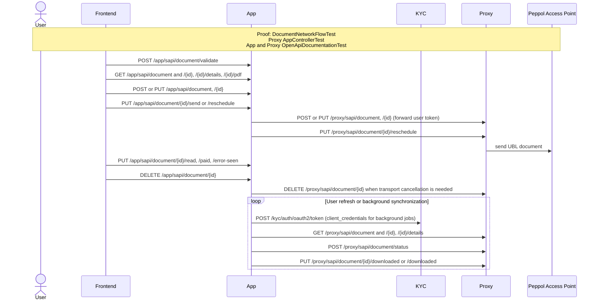

# Business-document lifecycle and Peppol transport

This flow follows a business document from validation and local persistence through Proxy transport,
status synchronization, download acknowledgement, cancellation, and user-visible state changes.

Executable proof: [`DocumentNetworkFlowTest`](../app/backend/src/test/java/org/letspeppol/app/service/DocumentNetworkFlowTest.java) covers App-to-Proxy calls, while [`AppControllerTest`](../proxy/src/test/java/org/letspeppol/proxy/controller/AppControllerTest.java) covers Proxy's acting-user validation. OpenAPI documentation tests guard every route in the grouped notes.

Document route coverage: the grouped App reads and actions include
`/app/sapi/document/{id}/details`, `/app/sapi/document/{id}/pdf`,
`/app/sapi/document/{id}/reschedule`, `/app/sapi/document/{id}/paid`, and
`/app/sapi/document/{id}/error-seen`. Proxy polling includes
`/proxy/sapi/document/{id}/details` and the batch acknowledgement route
`/proxy/sapi/document/downloaded`.

## Recommand send authorization failures

When a Recommand send returns HTTP 401, Proxy checks `GET /api/v1/companies/{companyId}`.
A 404 confirms that the stored company registration is stale: Proxy marks only that company's
local registry entry as unregistered (`NONE`) and completes the document with a clear registration
error. It preserves the registration variables for diagnosis and makes no remote deregistration call.

If the lookup succeeds or fails for another reason (including HTTP 401), Proxy keeps the company
registered. It allows three send attempts in total, an hour apart, and stops retrying 24 hours after
the first authorization failure. Retry state is stored in the document's existing JSON details,
so restarting Proxy does not reset the limit. A successful retry clears that state.

Final failures use the existing `processedOn`/`processedStatus` fields, which App synchronizes and
uses for its existing document-error notifications. Support can filter Proxy logs on
`PEPPOL_SEND_AUTHORIZATION_FAILED` for the document ID, sender, provider, and missing-company result;
`PEPPOL_SEND_AUTHORIZATION_RETRY` records scheduled retries. No separate support notification service
or database migration is required.

Tests: [`RecommandServiceTest`](../proxy/src/test/java/org/letspeppol/proxy/service/RecommandServiceTest.java),
[`UblDocumentSchedulerServiceTest`](../proxy/src/test/java/org/letspeppol/proxy/service/UblDocumentSchedulerServiceTest.java),
and [`RegistryServiceTest`](../proxy/src/test/java/org/letspeppol/proxy/service/RegistryServiceTest.java).

Return to the [API network flow guide](./api-network-flows.md).
