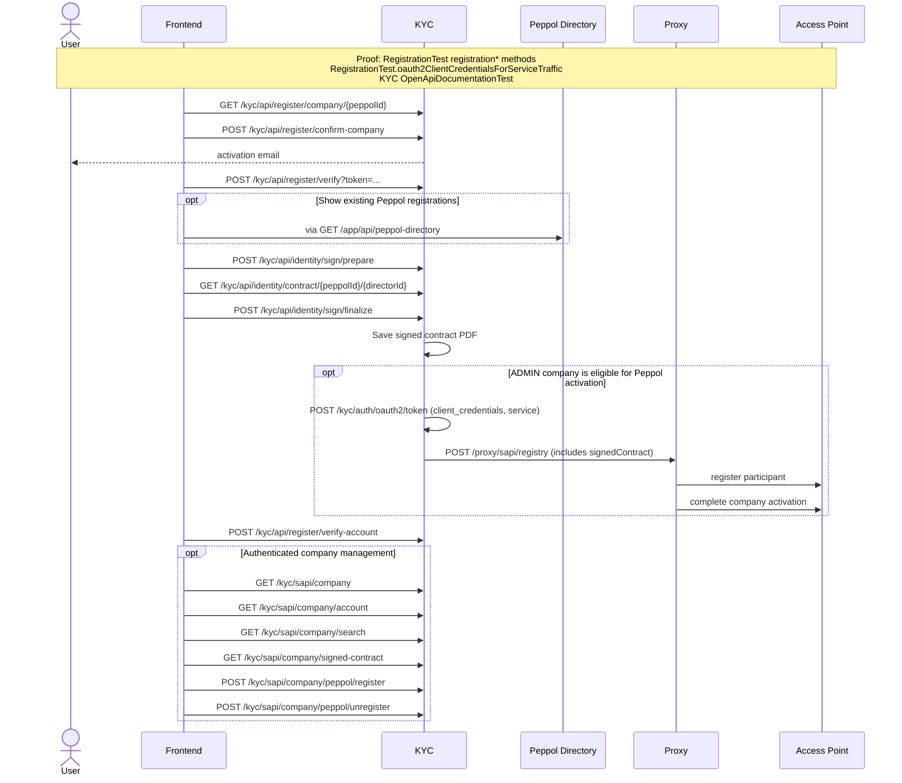

# Registration, identity signing, and company activation

The detailed registration variants are grouped in [KYC and registration flows](./kyc.md). This page
shows their shared public onboarding, identity signing, account verification, and service-only
registry traffic.

Executable proof: [`RegistrationTest`](../kyc/src/test/java/org/letspeppol/kyc/controller/RegistrationTest.java) exercises every variant, the service token, and the downstream registry call; [`OpenApiDocumentationTest`](../kyc/src/test/java/org/letspeppol/kyc/OpenApiDocumentationTest.java) keeps the endpoint catalogue aligned.



An affiliate-originated request uses `POST /kyc/sapi/linked/request-company`. The verification
response includes its requester, but there is currently no affiliate approval mutation API; the
older diagrams' nonexistent `/app/sapi/affiliate/**` calls have therefore been removed.

KYC saves the signed PDF under `CONTRACT_DATA_DIR/contracts` before requesting registration.
The service-only registry request carries it as the Base64-encoded JSON field `signedContract`.
Later activation attempts reload the company's ADMIN contract from the same storage.
Registration is successful only after the access point confirms company activation.
If activation fails, the proxy attempts to delete the newly created company so registration
can be retried. Failed cleanup is logged; the signed contract remains available in KYC.

Executable proof: [`CompanyRegistrationContractTest`](../kyc/src/test/java/org/letspeppol/kyc/service/CompanyRegistrationContractTest.java)
checks contract forwarding and retention after failure;
[`RecommandServiceTest`](../proxy/src/test/java/org/letspeppol/proxy/service/RecommandServiceTest.java)
checks company activation, response handling, and cleanup on failure.

Return to the [API network flow guide](./api-network-flows.md).

## Operator move between access points

From the deployment host (the existing internal Traefik entrypoint):

```sh
curl --fail-with-body -X POST \
  -H 'Content-Type: application/json' --data-binary @registration.json \
  'http://localhost:8443/proxy/lapi/registry/0208:0123456789/move?accessPoint=RECOMMAND'
```

`registration.json` uses the existing registration payload: `name`, `language`, `country`,
`address`, `postalCode`, `city`, `vatNumber`, and `signedContract` (the signed PDF encoded as Base64).
The operator supplies the actual company details. A signed contract from KYC storage is required
when either the source or target is Recommand, so the source can also be restored on failure.

The optional `accessPoint` parameter selects the target: `SCRADA`, `RECOMMAND`, or `E_INVOICE`,
provided its provider is available. If omitted, the target defaults to `proxy.access-point`.
The source is the company's current registration. `NONE`, `LOOPBACK`,
unknown targets, and unavailable providers are rejected before deregistration.

This local endpoint uses the existing provider registry and methods. An explicit `accessPoint`
overrides the configured default. It restores the previous provider if the move fails.
Each provider owns its registration requirements through `AccessPointServiceInterface.validateRegistration`.
Both providers are validated before deregistration, including the source's requirements for recovery.
The response is HTTP 200 on success, or HTTP 424 with the resulting `accessPoint` and
`peppolActive` state on failure. If recovery also fails, the registration is marked inactive.
Selecting the current provider is a no-op.

This hidden LAPI endpoint relies on the internal-only router, bound to localhost by default.
The public blue/green routers exclude LAPI paths. The ordinary registration APIs and services
retain their original implementation; all migration logic is confined to this LAPI controller.
