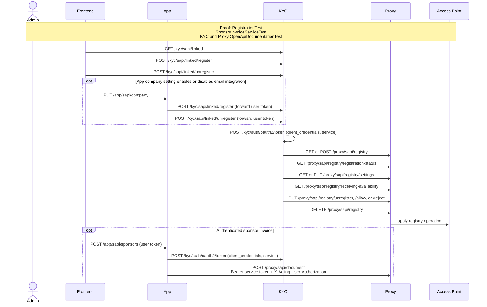

# Service links, registry control, and sponsor invoices

This flow groups authenticated service-link settings with service-scoped registry operations and
sponsor-invoice submission. It distinguishes the user's access token from a service token carrying
the acting-user authorization header.

Executable proof: [`RegistrationTest`](../kyc/src/test/java/org/letspeppol/kyc/controller/RegistrationTest.java) proves KYC's registry call; [`SponsorInvoiceServiceTest`](../app/backend/src/test/java/org/letspeppol/app/service/SponsorInvoiceServiceTest.java) proves client-credentials document submission; Proxy and KYC OpenAPI tests cover the management routes.

Registry route coverage: `/proxy/sapi/registry/allow` and `/proxy/sapi/registry/reject` are the two
app-link decisions represented by "apply registry operation".
`/proxy/sapi/registry/registration-status` also reports the configured default provider;
`/proxy/sapi/registry/settings` reads or updates provider-specific receiving settings.
`/proxy/sapi/registry/receiving-availability` uses the configured local SMP when the
default provider is PHOSS, otherwise Recommand discovery. PHOSS reports metadata
availability without claiming that LetsPeppol receiving is enabled. It does not
expose AP credentials or internal SMP URLs in its response.

PHOSS registration is initially a local **send-only association**, not public SMP
registration. Receiving cannot be enabled through this adapter yet. See the
[PHOSS integration guide](./phoss-access-point.md) for transport and local-lab limits.
Focused proof: [`PhossServiceTest`](../proxy/src/test/java/org/letspeppol/proxy/service/PhossServiceTest.java).

Return to the [API network flow guide](./api-network-flows.md).
