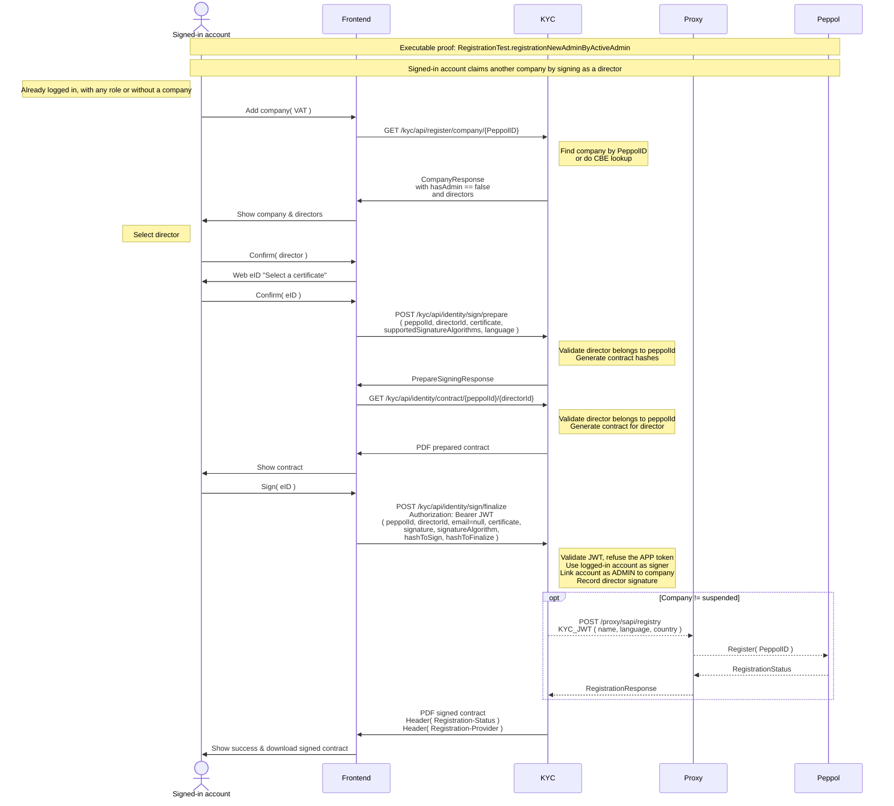

# Registration new ADMIN by a signed-in account

Any signed-in account can add a company it is a director of: an ADMIN, a USER or AFFILIATE of another
company, or an account that is no longer linked to any company. Only the APP service token is refused.

Executable proof: [`RegistrationTest`](../kyc/src/test/java/org/letspeppol/kyc/controller/RegistrationTest.java), method `registrationNewAdminByActiveAdmin`.

